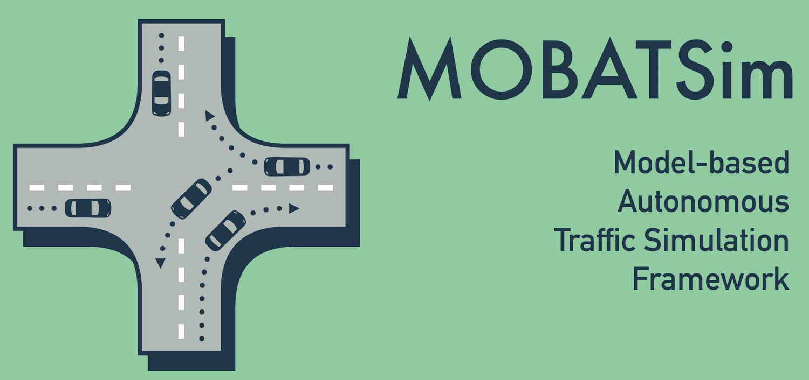

# **MOBATSim**

MOBATSim (Model-based Autonomous Traffic Simulation Framework) is a simulation framework based on MATLAB® and Simulink® that provides a set of customizable models and code for simulating automated driving systems. The project's main goal is to help users/students jump-start with a baseline template that lets them run traffic simulations, which also allows them to customize/experiment with path planning, decision-making, and control algorithms. The main use case is to run automated traffic simulations using Simulink models and MATLAB scripts/functions on a default map with streets and an intersection. By defining a driving scenario, the starting and destination points of the vehicles are set as initial conditions on the map. The trajectories of the simulated vehicles can be logged to assess the safety and the performance of the tested algorithm/controller or to visualize their behaviors using supported 2D and 3D visualization options. If you would like to read more about MOBATSim and how it can be used for simulation-based testing, make sure you check our [scientific paper](https://www.sciencedirect.com/science/article/pii/S2405896319304100).


[](https://github.com/MOBATSim/MOBATSim)
[](https://github.com/MOBATSim/MOBATSim/releases/)
[](#citation)




# Table of contents
1. [Version and Toolbox Requirements](#VersionRequirements)
2. [Citation](#citation)
3. [License](#license)
4. [Contributors](#contributors)
5. [Getting Started](#gettingstarted)


<a name="VersionRequirements"></a>

## **Version and Toolbox Requirements** 

MOBATSim is developed with Release 2020b of MATLAB® and Simulink®. There may be issues and unexpected errors with other versions. Therefore, for running MOBATSim, the requirement is **R2020b** version for the following MathWorks products and toolboxes:

* MATLAB®
* Simulink®
* Automated Driving Toolbox™
* Control System Toolbox™
* Deep Learning Toolbox™
* Model Predictive Control Toolbox™
* Robotics System Toolbox™
* Simulink 3D Animation™ (only required for the 3D Animation Virtual World)
* Stateflow®
* Symbolic Math Toolbox™


<a name="citation"></a>
## Citation

**If you use MOBATSim for scientific work please cite our related paper as:**

Saraoglu, M., Morozov, A., & Janschek, K. (2019). MOBATSim: MOdel-Based Autonomous Traffic Simulation Framework for Fault-Error-Failure Chain Analysis. IFAC-PapersOnLine, 52(8), 239–244. Elsevier BV. Retrieved from https://doi.org/10.1016%2Fj.ifacol.2019.08.077

BibTex:
```
@article{MOBATSim,
                title = {MOBATSim: MOdel-Based Autonomous Traffic Simulation Framework for Fault-Error-Failure Chain Analysis},
                journal = {IFAC-PapersOnLine},
                volume = {52},
                number = {8},
                pages = {239-244},
                year = {2019},
                note = {10th IFAC Symposium on Intelligent Autonomous Vehicles IAV 2019},
                issn = {2405-8963},
                doi = {https://doi.org/10.1016/j.ifacol.2019.08.077},
                url = {https://www.sciencedirect.com/science/article/pii/S2405896319304100},
                author = {Mustafa Saraoglu and Andrey Morozov and Klaus Janschek},
                keywords = {Autonomous driving, Fault injection, Error propagation, Safety analysis, Traffic simulator},
}
```

**Other papers published by our research group related to MOBATSim:**

```
@article{HART2019,
                title = {Fail-safe Priority-based Approach for Autonomous Intersection Management},
                journal = {IFAC-PapersOnLine},
                volume = {52},
                number = {8},
                pages = {233-238},
                year = {2019},
                note = {10th IFAC Symposium on Intelligent Autonomous Vehicles IAV 2019},
                issn = {2405-8963},
                doi = {https://doi.org/10.1016/j.ifacol.2019.08.076},
                url = {https://www.sciencedirect.com/science/article/pii/S2405896319304082},
                author = {Fabian Hart and Mustafa Saraoglu and Andrey Morozov and Klaus Janschek},
                keywords = {Traffic control, scheduling algorithms, autonomous vehicles, safety-critical},
}
```

```
@article{SARAOGLU2022,
                title = {Designing a Safe Intersection Management Algorithm using Formal Methods},
                journal = {IFAC-PapersOnLine},
                volume = {55},
                number = {14},
                pages = {22-27},
                year = {2022},
                note = {11th IFAC Symposium on Intelligent Autonomous Vehicles IAV 2022},
                issn = {2405-8963},
                doi = {https://doi.org/10.1016/j.ifacol.2022.07.577},
                url = {https://www.sciencedirect.com/science/article/pii/S2405896322009880},
                author = {Mustafa Saraoglu and Johannes Pintscher and Klaus Janschek},
                keywords = {Formal methods, safety, design, verification, autonomous systems, traffic control},
}
```

Apart from the papers listed above, the PhD thesis by Mustafa Saraoğlu, entitled *On Safety Assessment of Automated Driving Systems Using Simulation-based Testing and Formal Methods*, provides relevant information about the structure of the simulation framework in certain sections of the work.


<a name="license"></a>
## License

Please refer to the [LICENSE](https://github.com/MOBATSim/MOBATSim/blob/main/LICENSE) file in the project root directory for the terms and conditions.

<a name="Contributors"></a>
## Contributors

**We would like to acknowledge the help and support in the development of MOBATSim of the following contributors:** Sheng Ding, Manuel Schirmer, Johannes Pintscher, Laura Slabon, Qianwei Yang, Qihang Shi, Wenkai Wu, Maoxuan Zhao, Erik Noack, Fabian Hart, Müjdat Korkmaz, Marta Valdes Martin, Mustafa Saraoğlu.
Please refer to the CONTRIBUTORS.md file for a more detailed list of contributions. Additionally, each file contains a list of individual contributors at the top or bottom.

**We would like to express our sincere gratitude to Prof. Dr. techn. Klaus Janschek (2017-2024) and Herr Jun.-Prof. Dr.-Ing. Andrey Morozov (2017-2020) for their invaluable guidance, support, and expertise throughout the course of this project.**

**Information about MOBATSim, other research projects at our institute, as well as relevant acknowledgments for project management, the team, and funding can be found here:**  https://tu-dresden.de/ing/elektrotechnik/ifa/at/forschung/research-projects

<a name="gettingstarted"></a>
## Getting Started

MOBATSim has a project file that includes the Simulink files and their paths. The project can be opened by double-clicking on `MOBATSim.prj` and a GUI will appear, which can be used to start the simulation. Simply click on `Start Simulation` and wait for the simulation to start.
After opening the **MOBATSim** folder please refer to the live script file `GettingStarted.mlx` for more detailed documentation.

### **Key Features of MOBATSim** 

* Most of the scripts, class files, and functions used in MOBATSim can be edited to control the vehicles, intersection management algorithm, and the map's road network.
* Each vehicle is considered as an agent, and the traffic is simulated as a closed-loop multi-agent system. The vehicles generate their trajectories during the simulation according to the states and intentions of the other vehicles around in the environment.
* Users can either develop an algorithm or a controller for a single vehicle (usually referred to as the ego vehicle) or different implementations for different vehicles simultaneously.
* Full control over all the internal states of the vehicles during simulation allows for fault injection and error propagation analysis. The states and the signals can be easily manipulated by implementing some Simulink fault injection blocks or inserting some code snippets in MATLAB System Block functions.
* The results can be used for benchmarking control and decision algorithms regarding safety, robustness and performance on different abstraction levels such as component level, vehicle level, and traffic level.
* Object-oriented programming structure (MATLAB Classes) combined with a block diagram environment (Simulink) allows for a flexible framework.
* The vehicles and the map are shown on a 2D plot during the simulation. After a single simulation, the data logged in Simulink can be used for various post-simulation visualization options (e.g., Driving Scenario Designer App, Bird's-Eye View Scope, or Simulink 3D Animation).

### Known Issues and Bugs

* Vehicles are not allowed to choose any node inside or around the intersection as starting or destination points.
* Some road merges do not have safety guarantees which means that collisions may happen if two vehicles join at the same time.
* Changing the default sample time value of `0.02` or playing with different **Simulink Solver** options other than `auto` may cause unexpected behavior.


Contributors: Mustafa Saraoğlu, Laura Slabon, Erik Noack, Müjdat Korkmaz, Marta Valdes Martin
